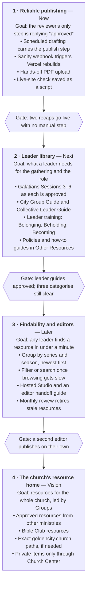

# Resources Page Roadmap

*As of October 25, 2026. Living plan; no delivery dates are set.*

The resources page grows from a library of weekly handouts into Golden City Church's home for group leaders: one trusted place to prepare, lead, and grow, with publishing that takes minutes.

## Vision

A leader opening [resources.goldencity.church](https://resources.goldencity.church/) on a Tuesday night should find what they need for Thursday's gathering in under a minute, and find what helps them grow as a leader the rest of the week.

- **For group leaders first.** Weekly Recaps and study handouts for the gathering, then leader training, how-to guides, and the approved policies leaders sign.
- **Christ at the center.** Every resource serves Scripture, prayer, shared life, and faithful response; formation over information.
- **Small and trustworthy.** A short, well-kept library beats a large one. Every item is reviewed, current, and safe to share publicly.
- **Human review stays the gate.** Drafts (including AI drafts) never publish without the Groups ministry director's review; pastoral and policy content keeps pastoral review where it applies.
- **Boundaries hold.** No participant names, prayer requests, pastoral records, or third-party material without permission. Ordinary Sanity files are public, so anything private stays in Church Center or other controlled systems.

## Where we are today

| Area | Current state |
| --- | --- |
| Library | City Groups: Weekly Recaps Love, Joy, Peace, Patience · Collectives: Galatians 1–2, Men's and Women's · Other: GCC Group Leader Agreement |
| Each resource | Reading page plus in-page PDF preview and download |
| Stack | Astro on Vercel (`paul-canaan`), content in Sanity (`1consdwv` / `production`), code in this repository |
| Address | `goldencity.church/groups/resources` redirects to `resources.goldencity.church` |
| Publishing | Review → Sanity entry → PDF upload → publish → manual Vercel redeploy → live check |

**Known gaps:** CMS changes don't deploy on their own; the PDF upload still needs a manual step; only one editor today, with no hosted Studio; two Sanity CLI dependency advisories (`braces`, `uuid`) are open.

## Roadmap

Each phase opens when the gate before it is met; dates get set once Phase 1 is done and the pace of approvals is clear.

## Improving the publishing process

The goal is a publish where the reviewer's only step is saying "approved".

**Target workflow (Weekly Recap)**

1. Sunday evening: scheduled drafting produces the recap record and PDF and sends them for review.
2. The reviewer edits if needed and replies "approved".
3. The Sanity entry is created, the PDF uploaded, and the entry published.
4. Publishing in Sanity triggers the Vercel rebuild automatically.
5. The live card, reading page, preview, and download are checked; the link goes back to the reviewer.
6. The release is recorded in the ignored `.sanity/publication-<date>.json`.

**Changes that get us there**

| Change | Removes | Effort |
| --- | --- | --- |
| Scheduled drafting carries the publish step, with Sanity and Vercel access | Manual hand-off after review | Minutes |
| Sanity webhook → Vercel Deploy Hook (publish, unpublish, delete; drafts ignored) | Manual rebuild | About an hour; test adding and removing |
| Hands-off PDF upload (private token kept out of Git, or an upload step in a Vercel Sandbox) | Manual upload command | About an hour |
| Save the live-site check as a script in this repository | Rebuilding the check each release | Small |
| One publish checklist for every resource type | Per-type guesswork | Small |
| Monthly content review | Outdated resources | 15 minutes a month |

## Guides

- [Managing content in Sanity](guides/sanity-content.md)
- [Deploying with Vercel](guides/vercel-deploy.md)

## Open decisions

- Which leader training is published first: City Group Guide, Collective Leader Guide, or Belonging, Beholding, Becoming training.
- Whether other editors get Studio access, and whether a hosted Studio is worth it then.
- Whether any leader-only resources are needed; if so they belong in Church Center, not this public site.
- CoJourner: link to the source, or seek permission to republish.
- Which resources need pastoral review before publishing, beyond new theological or policy content.
